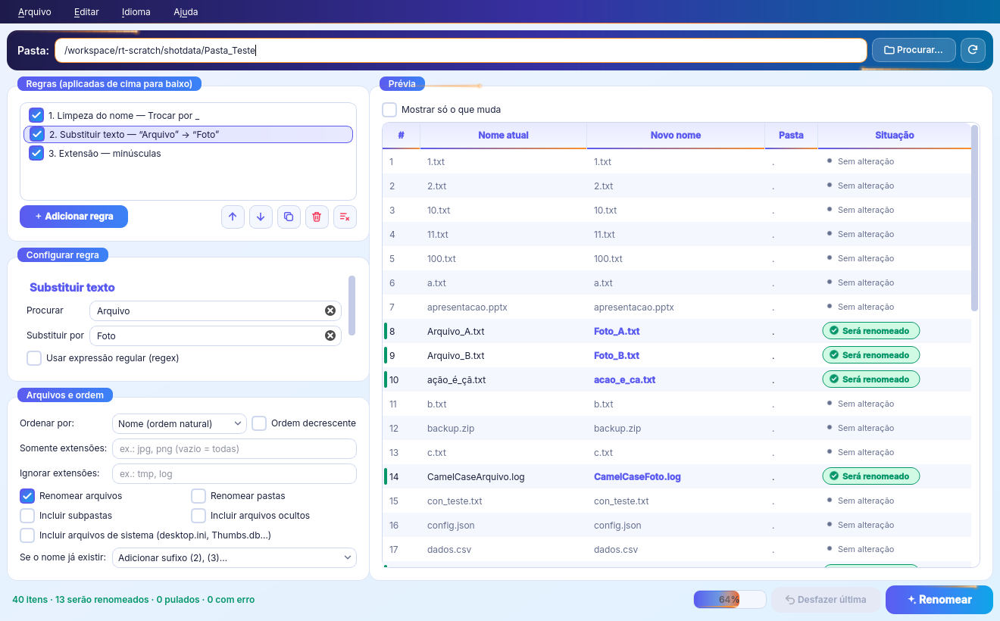
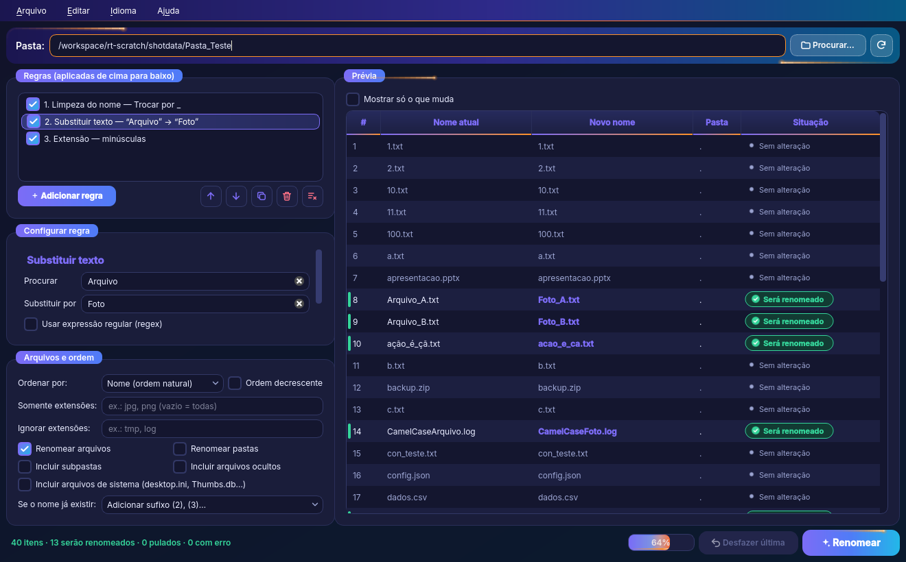

<p align="center">
  
</p>

<h1 align="center">Renemya</h1>

<p align="center">
  Safe, reversible — and good-looking — batch file renamer.<br>
  🇧🇷 <a href="README.md">Versão em português</a>
</p>

**Renemya** (the new name of *Rename This!*) renames thousands of files at once, and does it
**quickly, predictably and safely**. It is a from-scratch rewrite in **Python + PySide6 (Qt)**.
Before it touches anything it shows a full preview, refuses dangerous names, never overwrites a
file, and lets you **undo** the last operation. The interface is available in **15 languages**:
Portuguese (Brazil), English, Spanish, Simplified Chinese, Hindi, Arabic, French, Russian, Bengali,
Japanese, German, Indonesian, Korean, Turkish and Italian.

<p align="center">
  
  
</p>

## Download

Get the latest version from **[Releases](https://github.com/cleitinhodev/renemya/releases/latest)**:

| System | File |
|---|---|
| **Windows 10/11 (64-bit)** | `Renemya-<version>-windows-x64.zip`: portable, so just unzip it and run `Renemya.exe` |
| **Linux x86-64** | `Renemya-<version>-linux-x64.tar.gz`: extract it, then run `./install.sh` (or `./renemya`) |
| **Linux (single file)** | `Renemya-<version>-x86_64.AppImage`: only when the Release includes one |

Each package includes the user guide (`README.md`, `LEIA-ME.html`) and the license (`LICENSE.txt`).
Use `SHA256SUMS.txt` to verify your download. The full step-by-step tutorial is in Portuguese in
the [README](README.md); a short English guide follows below.

<!-- GUIA:INICIO (gerado de docs/guide.en.md; edite lá e rode packaging/build_release.py sync-readme) -->

## 🇺🇸 English (short guide)

**Renemya** is a safe batch file renamer: combine rules, check the live preview, rename, and undo
whenever you want. Links: [Releases](https://github.com/cleitinhodev/renemya/releases) ·
[source code](https://github.com/cleitinhodev/renemya) ·
[issues](https://github.com/cleitinhodev/renemya/issues) ·
[author](https://github.com/cleitinhodev) · [website](https://www.bugzinho.com/) ·
[donate](https://www.bugzinho.com/donate).

**Install.**
- **Windows:** unzip `Renemya-<version>-windows-x64.zip` and run `Renemya.exe` (portable). If
  SmartScreen appears, click *More info → Run anyway*.
- **Linux** (glibc 2.35+): `tar -xzf Renemya-<version>-linux-x64.tar.gz`, then
  `cd Renemya-<version>-linux-x64 && ./install.sh`. The installer puts the app in `~/.local/bin`
  and adds a menu entry. Or just run `./renemya`. Qt and its xcb libraries are bundled; you only
  need OpenGL/EGL (Mesa) and fontconfig. If you see "Qt platform plugin xcb", install
  `libxcb-cursor0 libxkbcommon-x11-0`.

**How to use.**
1. Pick or drag a folder into the window.
2. Add rules. They run top to bottom; drag to reorder, or untick to disable. There are 12 rules:
   prefix/suffix, replace (regex), remove characters, insert, counter, letters,
   date (modified/created/EXIF), case, cleanup, extension, template with tokens, music tags.
3. Set the sorting and filters, and choose the conflict policy: add a (2) suffix, or skip.
4. Read the preview:
   - green: will be renamed
   - orange: warning
   - gray: skipped
   - red: error (blocks renaming)
   - dot: unchanged
5. Click **Rename**. Undo with **Ctrl+Z**. Your history is under *File → Operation history*.
6. Save and load rule sets with *File → Save/Load preset*. You can also switch the language
   (*Language*), turn off the animations (*Edit → Animations*), and the theme follows the system.
7. Languages: Português (Brasil), English, Español, 中文（简体）, हिन्दी, العربية, Français, Русский,
   বাংলা, 日本語, Deutsch, Bahasa Indonesia, 한국어, Türkçe and Italiano. On first run Renemya follows
   the system language (English if it isn't listed); Arabic uses a right-to-left layout. Force one
   with `RENEMYA_LANG` (e.g. `RENEMYA_LANG=ja`).

**CLI:**
`renemya-cli rename ./photos --sort modified --template "Trip_{exif:%Y-%m-%d}_{n:03}" --dry-run`.
Other commands: `renemya-cli rules`, `undo`, `history`, `recover`, and `--lang <code>` (e.g. `--lang ja`).

**Why did the extension change?** Only the Extension rule, Replace (scope *extension*/*full
name*) or Case (*also the extension*) touch it. Renaming an extension never converts the file,
so the preview shows a warning.

<!-- GUIA:FIM -->

## Highlights

### Safety first
- **Plan, then apply.** Every new name is computed and validated before any file is touched.
  If there is an error, nothing is renamed.
- **Never overwrites.** Conflicts are resolved in the preview, either by adding a ` (2)`, ` (3)`…
  suffix or by skipping the file. When renaming, the program uses the OS calls that refuse an
  existing target (Linux/macOS) and runs a final check before every step.
- **Swaps and chains work.** Cases like `a → b` plus `b → a`, or `1.txt → 2.txt → 3.txt`, go
  through temporary names in two phases.
- **Automatic rollback.** If something fails midway (file open in another program, permission
  denied…), everything already done is reverted.
- **Undo and history.** Every operation is recorded in a JSON journal. You can undo the last one
  from the GUI, with `Ctrl+Z`, or from the CLI.
- **Crash recovery.** If the computer shuts down during an operation, the next launch offers to
  restore the original names.
- **Windows-safe names on every OS.** Blocks:
  - the characters `\ / : * ? " < > |` and control characters
  - reserved names (`CON`, `NUL`, `COM1`…)
  - a trailing dot or space, names over 255 bytes, and `..`
  - names that differ only in letter case, on filesystems that ignore case
- **System files protected.** `desktop.ini`, `Thumbs.db`, `.DS_Store` and hidden files are left
  alone unless you choose to include them.

### Composable rules
Rules are applied top to bottom. Each one can be enabled, disabled, duplicated or reordered:

- **Prefix / suffix**
- **Replace**: case sensitivity, **regex**, and whether it applies to the name, the extension or both
- **Remove**: specific characters, a range, the first or last N characters, digits, or text in `()` `[]` `{}`
- **Insert**: text at a position, counting from the start or the end
- **Counter**: start, step, zero padding, position and separator; can restart per folder
- **Letters**: A, B, … Z, AA…
- **Date**: modified, created or **photo taken (EXIF)**, with a custom format
- **Case**: lower, UPPER, Title, Sentence, iNVERT
- **Cleanup**: spaces, accents, invalid characters, repeated separators
- **Extension**: lower, upper, change or remove
- **Template**: build the name from tokens
- **Music tags**: artist, title, album, track

Template tokens:
- `{name}`: original name; `{current}`: the name after the previous rules
- `{ext}`, `{parent}`, `{size}`
- `{n:03}`: counter; `{letter[:lower]}`: letters
- `{date|modified|created|exif|now[:%Y-%m-%d]}`: dates
- `{artist}` `{title}` `{album}` `{track:02}` `{year}` `{genre}`: music tags

### GUI
- Drag & drop folders.
- Live preview with color-coded statuses.
- Natural sorting by name, date, size or type.
- Extension filters, subfolders, folders, hidden and system files.
- Confirmation before applying, progress bar, final summary and Undo.
- JSON presets.
- 15 interface languages, switchable at runtime (Arabic with a right-to-left layout).
- Light/dark theme that follows the system, with **neon orange** accents (the fox's color):
  glowing streaks run along the header, the **Rename** button, the progress bar and the active
  panel. Turn them off in *Edit → Animations* (saved). They pause when the window is minimized
  or in the background.
- The last session is restored on launch.

## Install from source (Python 3.10+)

```bash
git clone https://github.com/cleitinhodev/renemya.git
cd renemya
python -m venv .venv && source .venv/bin/activate   # Windows: .venv\Scripts\activate
pip install -e ".[media]"   # media = EXIF dates (Pillow) + music tags (mutagen); optional
```

## Usage

```bash
renemya                     # GUI (or: python -m renemya)

renemya-cli rename ./photos --sort modified --template "Photo_{n:03}" --dry-run
renemya-cli rename ./photos --sort modified --template "Photo_{n:03}" -y
renemya-cli rename ./docs --add remove mode=brackets --add case mode=lower
renemya-cli rules | undo | history | recover
```

Exit codes: `0` success, `1` error or aborted, `2` usage error.

The journal and presets are stored in the platform's user data folder (for example
`%LOCALAPPDATA%\Renemya` on Windows). Set `RENEMYA_DATA_DIR` to use a different folder and
`RENEMYA_THEME=light|dark` to force a theme.

## Development

```bash
pip install -e ".[dev]"
ruff check . && ruff format --check . && pytest
```

CI runs lint and tests on Ubuntu and Windows. On every push to `main`, the **Build e Release**
workflow:
- builds the Windows and Linux (Ubuntu 22.04) executables with PyInstaller;
- smoke-tests them (`--smoke-test`);
- keeps the packages as workflow artifacts.

Pushing a `vX.Y.Z` tag that matches the version in `pyproject.toml` also publishes a GitHub
Release with these files:
- the Windows `.zip`;
- the Linux `.tar.gz`;
- the AppImage, if it built;
- `SHA256SUMS.txt`.

The user guide sources are `docs/guia.md` and `docs/guide.en.md`. Run
`python packaging/build_release.py sync-readme` after editing them.

## Credits

By [CleitinhoDEV](https://github.com/cleitinhodev). Support: [❤️ Donate](https://www.bugzinho.com/donate) · [Patreon](https://www.patreon.com/CleitinhoDEV) · [Bugzinho.com](https://www.bugzinho.com)

Licensed under **GPL-3.0**. Built with:
- PySide6 (LGPL-3.0)
- platformdirs (MIT)
- Pillow (MIT-CMU, optional)
- mutagen (GPL-2.0-or-later, optional)
